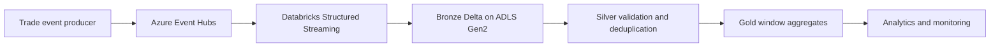

# Real-Time Trade Monitoring Pipeline

**Azure Event Hubs | Azure Databricks | PySpark Structured Streaming | ADLS Gen2 | Delta Lake**

## Business scenario
Build a near-real-time pipeline that consumes synthetic trade events, validates them, stores raw events, and produces event-time monitoring aggregates by instrument.

## Architecture

## Repository structure
- `data/sample_trade_events.jsonl`: synthetic event samples.
- `schemas/trade_event.schema.json`: event contract.
- `src/stream_to_bronze.py`: Event Hubs ingestion starter.
- `src/transform_silver.py`: parsing and validation helpers.
- `src/aggregate_gold.py`: event-time aggregation helper.
- `docs/architecture.md`: design and operational notes.
- `tests/TEST_PLAN.md`: validation checklist.

## Prerequisites
Azure Event Hubs, Azure Databricks with a compatible Event Hubs Spark connector, ADLS Gen2, Delta Lake support, and appropriate identity/access configuration.

## Configuration
Set `EVENTHUBS_CONNECTION_STRING`, `EVENTHUB_NAME`, `BRONZE_PATH`, and `CHECKPOINT_PATH` using Databricks secrets or secure environment configuration. Never commit credentials.

## Suggested implementation sequence
1. Provision Event Hubs and ADLS Gen2.
2. Configure secure access and confirm connector/runtime compatibility.
3. Run the Bronze streaming query with a durable checkpoint.
4. Implement Silver and Gold streaming writes and quarantine handling.
5. Validate duplicate, malformed and late-arriving events.
6. Add monitoring, alerts and measured throughput/latency results.

## Current implementation status
This repository contains project documentation, synthetic sample events, a schema contract, and starter PySpark code. **Live Azure deployment, end-to-end execution, DLT deployment, checkpoint recovery and performance testing have not yet been verified.** Treat these as implementation/validation tasks, not completed achievements.

## Data and security
All sample records are synthetic. Do not add employer/client data, secrets, access keys or production identifiers.
